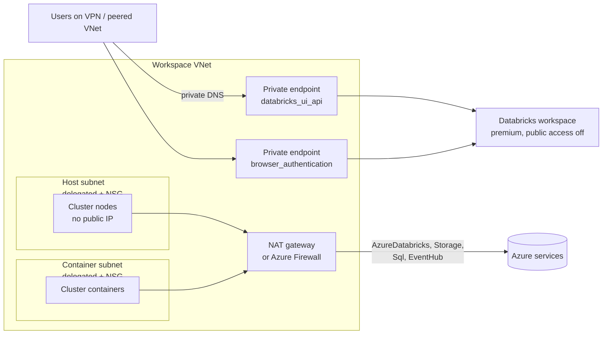

# Private Azure Databricks in Terraform

A Terraform module that deploys an Azure Databricks workspace with **no public surface**: clusters run without public IPs, the workspace refuses public network access, and both the UI/API and browser sign-in go through Private Link. Egress is explicit and has a single, known public IP.

It is the setup regulated teams usually ask for and usually end up clicking together by hand. Here it is one module, with plan-level tests that prove the security properties on every commit.

## What it builds



| Piece | Why |
|---|---|
| VNet injection with two delegated subnets | Clusters live in your network, so you control routing, NSGs and peering |
| `no_public_ip = true` (secure cluster connectivity) | Nodes never get public IPs; they reach the control plane over an outbound relay |
| `public_network_access_enabled = false` | The workspace URL only resolves and answers over Private Link |
| `NoAzureDatabricksRules` and a hand-written NSG | Databricks adds no rules of its own; the NSG holds exactly what clusters need |
| `databricks_ui_api` and `browser_authentication` private endpoints | Front-end Private Link for the UI, REST API and SSO callback |
| `privatelink.azuredatabricks.net` zone linked to the VNet | Name resolution to the private endpoints |
| Egress: NAT gateway (default) or Azure Firewall | One known outbound IP for allow-lists; firewall mode adds service-tag rules and a forced default route |

## Usage

```hcl
module "databricks" {
  source = "github.com/vikraj01/azure-private-databricks-terraform"

  name                = "analytics-dev"
  location            = "westeurope"
  resource_group_name = "analytics-dev-rg"

  egress_mode = "nat_gateway" # or "firewall", or "none" if a hub handles egress
}
```

A runnable example lives in [`examples/basic`](examples/basic).

```bash
cd examples/basic
az login
terraform init
terraform apply
```

After apply, the workspace URL only works from inside the VNet or from a network linked to the private DNS zone (a peered hub, VPN or ExpressRoute). Link `private_dns_zone_id` to your hub VNet, or forward the zone from your DNS servers.

## Inputs

| Name | Description | Default |
|---|---|---|
| `name` | Base name for every resource | required |
| `location` | Azure region | required |
| `resource_group_name` | Existing resource group | required |
| `vnet_address_space` | Workspace VNet range | `["10.20.0.0/22"]` |
| `host_subnet_cidr` / `container_subnet_cidr` | Databricks subnets, same size, /26 or larger | `10.20.0.0/24`, `10.20.1.0/24` |
| `private_endpoint_subnet_cidr` | Subnet for the private endpoints | `10.20.2.0/27` |
| `firewall_subnet_cidr` | `AzureFirewallSubnet`, firewall mode only | `10.20.3.0/26` |
| `egress_mode` | `nat_gateway`, `firewall` or `none` | `nat_gateway` |
| `create_browser_auth_endpoint` | One per region per DNS zone; turn off if another workspace already has it | `true` |
| `managed_resource_group_name` | Databricks managed RG name | `<name>-dbw-managed-rg` |
| `tags` | Tags for every resource | `{}` |

## Outputs

| Name | Description |
|---|---|
| `workspace_id` | Workspace resource ID |
| `workspace_url` | Workspace URL (private) |
| `vnet_id` | VNet ID, for hub peering |
| `private_dns_zone_id` | Private DNS zone to link elsewhere |
| `egress_public_ip` | The one public IP clusters egress from |

## Design decisions

- **Why the NSG is written by hand.** With back-end Private Link Azure requires `NoAzureDatabricksRules`, which means Databricks stops managing NSG rules. The module adds only worker-to-worker traffic and outbound to the `AzureDatabricks`, `Sql`, `Storage` and `EventHub` service tags on the documented ports.
- **Why NAT gateway is the default.** Secure cluster connectivity needs outbound access, and a NAT gateway is the cheapest way to give it a single static IP. Firewall mode is there when you need FQDN filtering or central logging; `none` is for a hub-and-spoke setup where the hub already routes egress.
- **Why the browser auth endpoint is optional.** Azure allows one `browser_authentication` endpoint per region per private DNS zone. The second workspace in a region must skip it or sign-in breaks.
- **Why premium.** Private Link is a premium-only feature.

## Testing

```bash
terraform init -backend=false
terraform test      # mocked provider: no Azure account needed
tflint --init && tflint --recursive
```

The tests check that the workspace is private, that clusters have no public IPs, that both subnets are delegated, that each egress mode creates exactly what it should, and that unknown egress modes are rejected. CI runs all of it on every push.

## Cost (estimate)

The network pieces are small next to compute: a NAT gateway plus its IP is roughly USD 35 to 45 a month before data processing; Azure Firewall Standard is roughly USD 900+ a month, which is why it is opt-in. Private endpoints are about USD 7 to 8 a month each. Databricks compute (DBUs plus VMs) dominates the bill. Check the Azure pricing calculator for your region.

## What I would add for production

- Customer-managed keys for managed services and DBFS
- Diagnostic settings to Log Analytics for the workspace, NSG flow logs and the firewall
- Unity Catalog metastore and an access connector with a managed identity
- Hub-and-spoke: peer to a hub that owns DNS and egress, and run with `egress_mode = "none"`
- Azure Policy assignments that deny public network access on new workspaces

## Licence

MIT
